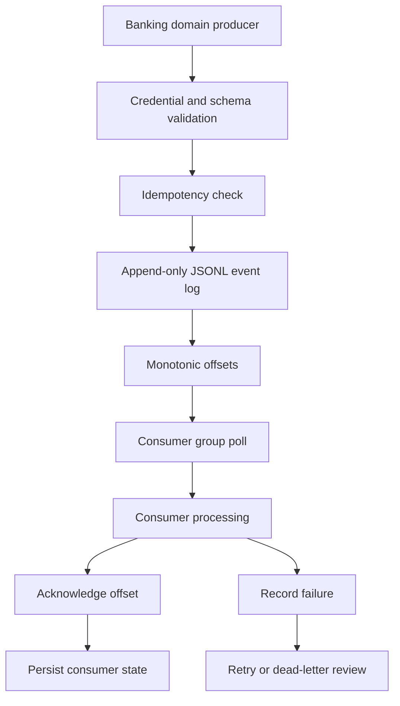

# Architecture

## Components

- **Producer API:** validates domain credentials, event envelope and schema.
- **Schema registry:** records event type, owning domain, version and required payload fields.
- **Append-only log:** stores each accepted event as one JSON line with a monotonic offset.
- **Consumer registry:** stores consumer status and last acknowledged offset.
- **Consumer API:** polls pending records and records sequential acknowledgements or failures.
- **Failure ledger:** tracks attempts, retryable failures and dead-letter state.
- **Monitoring UI:** reads stream metrics, consumer lag, schemas and failure records.

## Event flow

## Persistence model

- `events.jsonl`: append-only event records.
- `state.json`: schema definitions, consumer offsets, failure records and audit entries.
- State snapshots are written to a temporary file and renamed into place.
- The event log is appended before state metadata is persisted. On startup the event log is reloaded and event IDs are rebuilt from its contents.

This is a local single-process design. It does not provide cross-process locking, replicated durability, broker partitioning or transactional atomicity across multiple storage systems.
