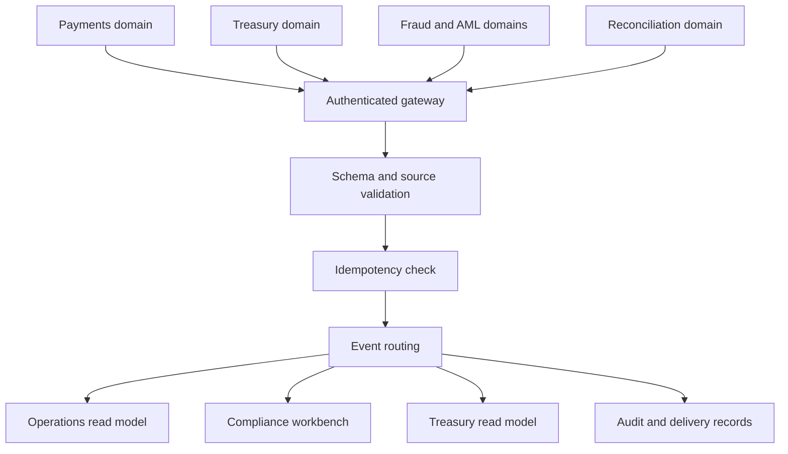

# Architecture

## Components

- Express API gateway validates domain credentials and event schemas.
- Versioned event envelope carries event ID, type, source, timestamp, correlation ID, subject ID and payload.
- Router maps source domains to named consumer destinations.
- Idempotency registry prevents duplicate event IDs from being accepted twice.
- Delivery records track consumer, attempt count, status and last attempt.
- Audit records capture publication, routing and retry actions.

## Flow

## Security boundary

Write operations require a bearer credential scoped to a source domain. Credentials are configured outside source control using `INTEGRATION_API_KEYS`, formatted as comma-separated `domain:key` pairs. Comparisons use constant-time byte comparison. This is a prototype key scheme, not a substitute for OAuth2 client credentials, mTLS, secret rotation, central identity, rate limiting or production API gateway controls.

## Delivery boundary

Consumer destinations are routing declarations only. Delivery status `delivered` means accepted by this local simulated router; it does not mean a remote application received or processed the event. No network calls are made to the other portfolio applications. The in-memory store is lost on restart.
