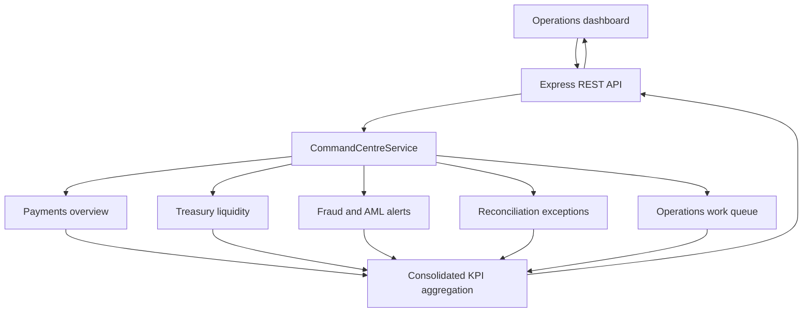

# Architecture

## Runtime components

- **Browser dashboard:** responsive HTML/CSS/JavaScript UI, polling consolidated REST endpoints every 30 seconds.
- **Express application:** static asset delivery, API routing, payload validation and error responses.
- **CommandCentreService:** seeded payment instructions, liquidity positions, cross-domain alerts, operational work items and audit events.
- **Aggregation layer:** calculates payment status counts, risk-alert totals, liquidity available/reserved values and work queue KPIs.
- **Workflow actions:** records alert acknowledgement/investigation/escalation/resolution and work item status changes.

## Data flow

## Design boundary

The domains are deliberately separated in the response model. In this version they are populated by static fixtures, not by calls to the independent portfolio project APIs. The design illustrates the command-centre experience and API contract without pretending that independent prototypes already interoperate.

## Production direction

Replace fixtures with authenticated domain adapters or event subscriptions. Use stable identifiers, versioned schemas, idempotent consumers, durable event storage, time-aware aggregations and per-domain freshness metadata. Preserve domain ownership rather than creating a second system of record.
