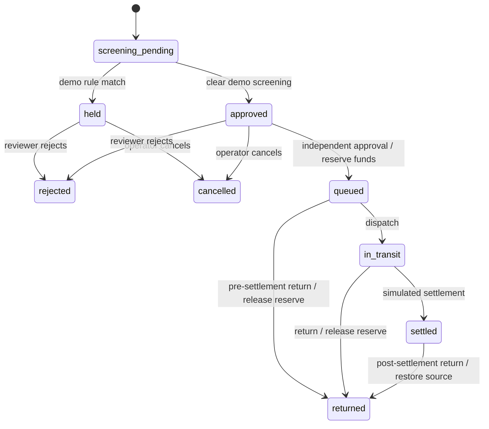

# Architecture

## Components

1. **Express API** — validates request payloads with Zod and exposes payment, FX, treasury and reconciliation endpoints.
2. **PaymentsService** — owns the in-memory account, beneficiary, quote, payment, statement and audit collections.
3. **Payment lifecycle** — screening, independent approval, liquidity reservation, dispatch, settlement and return/rejection paths.
4. **FX quote module** — quote creation, acceptance and expiry; rates are stored as scaled integers and converted with BigInt arithmetic.
5. **Message renderer** — produces illustrative pacs.008-style XML or MT103-style text.
6. **Reconciliation** — compares statement references, currency and minor-unit amounts against settled payment records.

## Lifecycle

## Monetary model

All stored amounts are integer minor units. FX rate is stored as an integer scaled by 10^8. Conversion uses BigInt multiplication and half-up division to avoid binary floating-point arithmetic in the conversion step. Seed currencies are GBP, USD and EUR, each treated as two-decimal currencies by this demo.

## Liquidity treatment

Approval reserves the source amount after checking available balance. Settlement reduces both the reserved amount and account balance. A pre-settlement return releases the reservation; a post-settlement return restores the source balance. This simplified model does not represent nostro/vostro accounting, fees, FX P&L or double-entry journal postings.

## Trust boundaries

The API, process memory, actor labels, country/name rules, FX input and message renderer are demonstration components. No external party validates any identity, rate, route, instruction or settlement event. Production architecture would require durable state, signed messages, authenticated service identities, role enforcement, replay-safe event handling, a ledger, network adapters, observability and independent controls.
