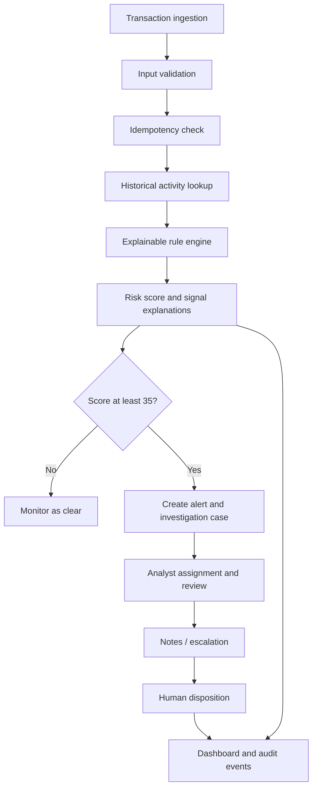

# Architecture

## Components

- **Express API:** request validation and REST endpoints.
- **FraudIntelligenceService:** in-memory transaction, case and audit collections.
- **Signal engine:** deterministic rules that produce weighted, human-readable risk indicators.
- **Case workflow:** analyst assignment, notes, escalation and disposition.
- **Network view:** groups transactions by counterparty identifier and reports the number of distinct customer IDs.
- **Dashboard aggregator:** summarizes risk bands, case statuses, alert rate and common signal codes.

## Data flow

## Risk bands

- Low: 0–34
- Medium: 35–59
- High: 60–79
- Critical: 80–100

A case is opened at 35 points. Risk points are additive and capped at 100. The engine is transparent and deterministic, not machine learning.

## Data and trust boundaries

All data is caller-supplied or synthetic. Country flags are a local illustrative list, not sanctions data. IP country and device identifiers are unverified strings. Actor names are not authenticated. Audit events are in process memory. No external service validates identity, device, geography, payment status or customer behaviour.
