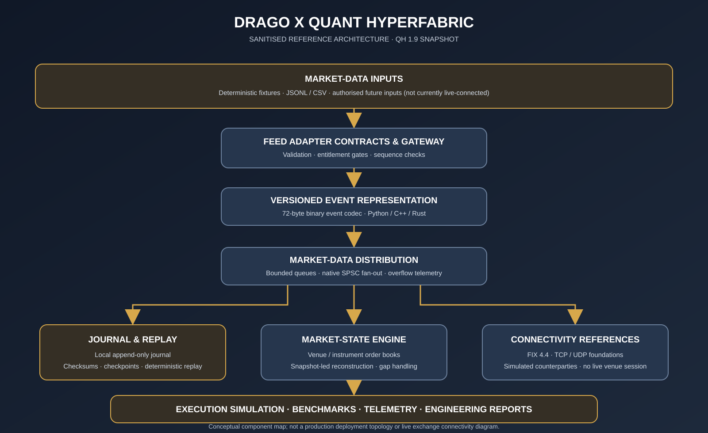
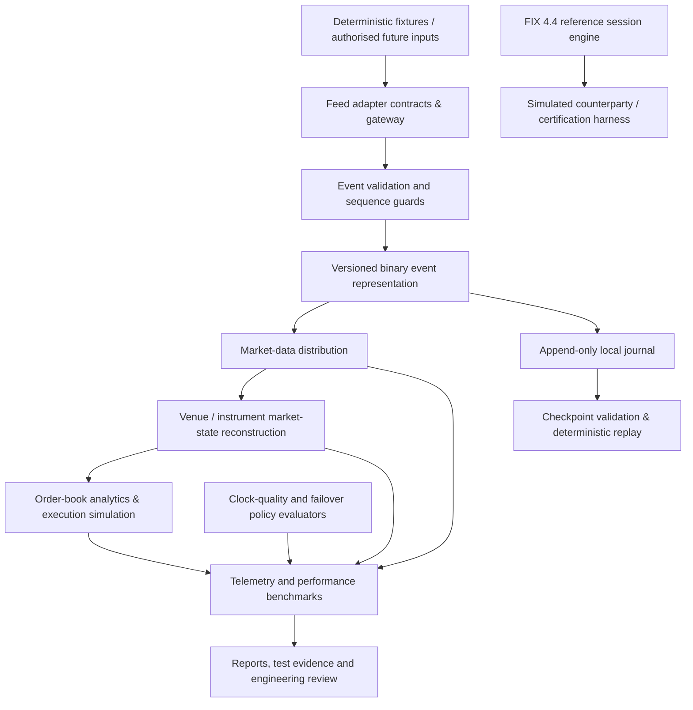

# DRAGO X QUANT HYPERFABRIC
## Public technical case study — sanitised overview

**Project category:** Quantitative finance infrastructure / market-data engineering  
**Implementation status:** QH 1.9 reference implementation (version 0.1.0-alpha)  
**Portfolio purpose:** Technical overview for reviewers; the underlying implementation repository is private.

> **Scope and disclosure:** This page describes implemented reference components and their limitations. It does not disclose proprietary source code, credentials, private configuration, customer information or exchange access details. It is not a claim of production deployment, independent certification, live exchange connectivity or institutional adoption.

## 1. Project overview




DRAGO X QUANT HYPERFABRIC is a modular research and engineering platform exploring the infrastructure required for reliable market-data processing, deterministic market-state reconstruction, execution simulation, venue connectivity and quantitative performance measurement.

The engineering objective is to make market events traceable and reproducible while keeping the system modular across software runtimes and deployment environments.

The current public description is deliberately conservative: this is a reference implementation and engineering research project, not a production trading platform.

## 2. Engineering problem

Quantitative systems depend on more than signal generation. They also depend on the quality and ordering of market data, correct reconstruction of order books, realistic execution assumptions, reliable connectivity state and the ability to reproduce failures.

The project investigates how these concerns can be represented as explicit components with testable contracts:

- Validate and normalise market events.
- Detect missing, duplicate, regressing or out-of-order sequence values.
- Reconstruct venue- and instrument-specific market state.
- Simulate execution against displayed depth with explicit assumptions.
- Preserve event history for deterministic replay.
- Measure software throughput and latency distributions.
- Model connectivity, recovery and venue-adapter behaviour without claiming live venue access.

## 3. Architecture at a glance



The diagram is a conceptual view of the reference components. It does not imply that all components are connected to live exchanges or deployed as one production service.

## 4. Implemented reference capabilities

| Area | Implemented reference capability | Important boundary |
|---|---|---|
| Market-data ingestion | JSONL/CSV event parsing, validation and deterministic fixtures | Not a live exchange feed |
| Event sequencing | Per-venue/instrument sequence checks; gap, duplicate and regression detection | Venue-specific retransmission and snapshot protocols are not generally integrated |
| Order-book reconstruction | Snapshot-led, incremental market-state reconstruction and stale/invalid-state handling | Python reference engine; not production exchange infrastructure |
| Execution simulation | Marketable limit-order simulation against displayed depth, fees and net execution economics | Simplified model; not a complete queue-position or market-impact simulator |
| Risk controls | Simulation-side notional limits and fail-closed reference policies | Not a production risk gateway |
| Binary event format | Versioned 72-byte network-order event codec | Reference format; not an exchange standard |
| Native data structures | C++ bounded lock-free SPSC ring buffer and fan-out primitives | SPSC contract; not MPMC; in-process primitives |
| Rust | Native decoder for the binary event frame | Decoder component, not a complete Rust trading engine |
| Storage and replay | Append-only local journal, checksums, checkpoints and deterministic replay | Single-writer local filesystem; not replicated HA storage |
| Connectivity | TCP/UDP transport foundations, reconnect/failover policy and FIX 4.4 session reference | Simulated/local test environments; no live venue session |
| Venue adapters | Adapter contracts, manifests, entitlement gates and deterministic certification fixtures | No exchange entitlements or live exchange certification |
| Benchmarking | Throughput and latency distribution summaries, including P50/P95/P99/P99.9 and maximum | Local software measurements; not exchange or hardware certification |
| Telemetry | Supplied infrastructure telemetry, trend estimates and advisory anomaly screening | Does not autonomously control physical hardware |

## 5. Performance benchmarking methodology

The benchmark framework is designed to report distributions rather than relying only on averages.

**Measurements**
- Throughput over a defined measurement interval.
- Mean latency.
- P50, P95, P99 and P99.9 latency.
- Maximum observed latency.
- Warm-up and measured iteration counts.
- Baseline comparisons for throughput and tail-latency regression.

**Method**
1. Define the workload and input fixture.
2. Record runtime, platform, configuration and iteration counts.
3. Execute warm-up iterations separately from measured iterations.
4. Use monotonic high-resolution timing for local measurements.
5. Calculate latency percentiles and throughput.
6. Compare against a declared baseline using explicit regression thresholds.
7. Preserve the report with the test run so results can be reviewed and reproduced.

**Interpretation limits:** benchmark values depend on the host, runtime, operating system, compiler, workload and measurement method. No numeric performance claim is made on this page. Local Python measurements do not establish production exchange latency, physical NIC timestamp accuracy, FPGA/GPU acceleration, or certified colocation performance.

## 6. FIX and venue-connectivity scope

The reference implementation includes FIX 4.4 message/session handling, sequence-state and recovery primitives, simulated counterparties, venue-profile validation, adapter manifests and a deterministic certification harness.

These components are intended to explore protocol correctness and testability. They do **not** establish a live connection to LSEG, CME, NYSE, Nasdaq, JPX, Euronext or any other exchange. No live market-data entitlement, production order routing, exchange certification or production counterparty integration is claimed.

## 7. Research direction — not yet implemented as a product

The following are proposed research and development areas, not completed product capabilities:

- Independent colocation fairness and performance auditing.
- Cross-venue latency comparison with clock uncertainty and timestamp provenance.
- Direct-feed versus consolidated/vendor-feed timing analysis.
- More realistic queue-position, partial-fill, adverse-selection and market-impact simulation.
- Venue-specific matching-engine behaviour models.
- Hardware timestamping, PTP integration and authorised packet-capture pilots.
- Live exchange connectivity and formal venue certification, subject to agreements and entitlements.
- Independent validation of measurement methods and benchmark results.

A proposed **Colocation Fairness & Performance Auditor** would require authorised participant-side instrumentation, properly licensed data, synchronised measurement clocks, documented uncertainty and controlled test conditions. It would not attempt to access restricted exchange systems or bypass venue controls.

## 8. Testing and reproducibility

The implementation contains automated tests and CI workflows for selected Python, C++ and Rust components. Relevant project-level commands documented in the private implementation include:

```bash
# Python test suite
pytest

# Rust codec tests
cargo test --manifest-path native/rust/Cargo.toml

# C++ SPSC ring-buffer test
g++ -std=c++17 -O2 -pthread \
  -I native/cpp/include \
  native/cpp/tests/spsc_ring_buffer_test.cpp \
  -o qh-spsc-test
./qh-spsc-test

# Local Python benchmark example
python scripts/run_benchmarks.py \
  --iterations 2000 \
  --output qh-benchmark-report.json
```

These commands are included as implementation references, not as a claim that they have been executed on the reviewer's machine. Reviewers should consult the relevant CI run and commit when assessing the current test state. No independent security audit or production performance certification is claimed.

## 9. Technology

- **Python:** event processing, reference analytics, simulation and benchmarking.
- **C++:** bounded SPSC queue and market-data fan-out primitives.
- **Rust:** binary event decoder.
- **FIX 4.4:** reference session and message handling.
- **SQLite:** local persistence for selected session state.
- **JSON / CSV:** fixtures, schemas and reports.
- **GitHub Actions:** automated build and test workflows.

## 10. What is not claimed

For clarity, this project is not represented as:
- A live exchange-connected trading system.
- A production order-routing or market-making system.
- An independently audited or certified platform.
- A proven source of trading alpha or investment returns.
- A physical FPGA/GPU/NIC/DPU orchestration product.
- A replicated high-availability market-data platform.
- A completed colocation fairness auditor.

## 11. Next validation milestones

1. Re-run and publish reproducible test evidence against a named commit.
2. Publish benchmark reports with host and workload metadata, without implying exchange-grade results.
3. Add realistic simulated queue position, partial fills and adverse-selection scenarios.
4. Validate clock measurement and event provenance with controlled test equipment.
5. Build an authorised pilot using licensed data or participant-approved feeds.
6. Obtain independent engineering review before making production-readiness claims.

## 12. Portfolio links

- [GitHub profile](https://github.com/JOHNEBSTER-X7)
- [DRAGO X QUANT HYPERFABRIC implementation repository](https://github.com/JOHNEBSTER-X7/JOHNEBSTER-X7-drago-x-quant-hyperfabric) — private; access is not available to public reviewers.
- [DRAGO X Protocol](https://github.com/JOHNEBSTER-X7/DRAGO_X_PROTOCOL_FC)

**Author:** John Ebster-Davids  
**Project:** DRAGO X QUANT HYPERFABRIC  
**Document type:** Sanitised public technical overview
